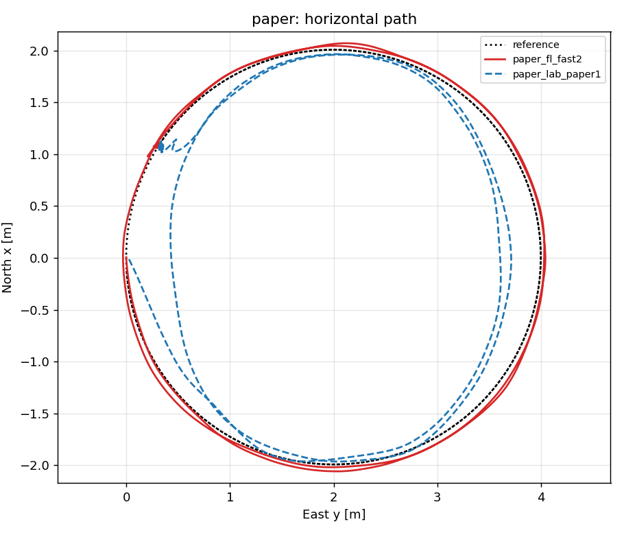
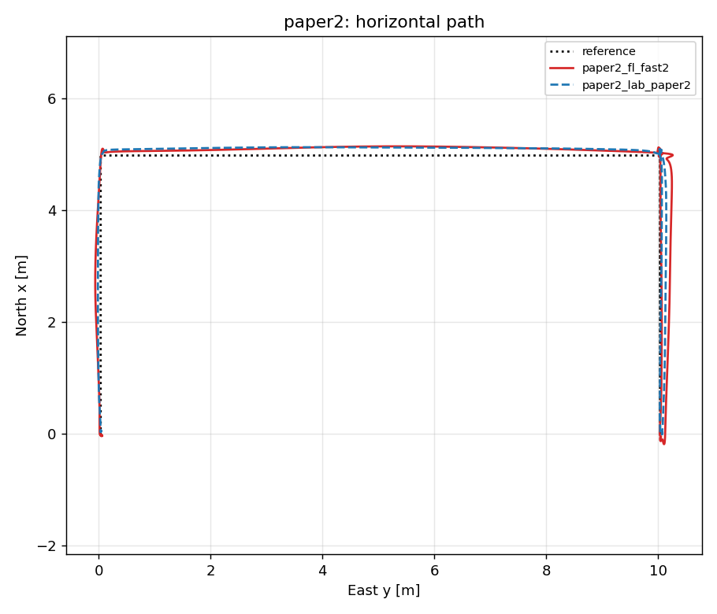
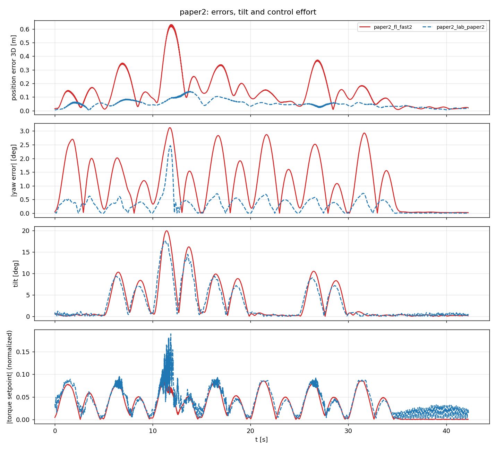

El paper (P. Albertos) diseña dos controladores de seguimiento de trayectoria para un cuadricóptero, LAB (basado en álgebra lineal) y FL (linealización por realimentación), y los prueba sobre una planta simulada ideal. Este repositorio los ejecuta como modos de vuelo nativos de PX4 v1.17, primero en Gazebo (x500) y después en un dron real. Este documento recoge qué ha habido que cambiar y por qué.

Todo lo que se dice "medido" sale de los vuelos en Gazebo (carpeta `Tools/lab_fl/plots/comparison/`) y de un estudio previo con modelos de planta. **No se ha volado nada en hardware real todavía.**

Vídeos de la segunda trayectoria en Gazebo: `Tools/lab_fl/videos/lab_paper2_gazebo.mp4` y `fl_paper2_gazebo.mp4` (puntos rojos: referencia cada 0,5 s; punto verde: inicio de la trayectoria).

# Resumen

| N.º | Tema | Paper | Aquí | Parámetro |
|---|---|---|---|---|
| 1 | Guiñada (yaw) en la dinámica de traslación | no aparece | se rota la aceleración horizontal con el rumbo | `TCC_HDG_COMP` (1) |
| 2 | Aceleración y jerk en FL | velocidad filtrada (0,2 s) | calculados con el modelo de la planta | `FL_MODEL_DERIV` (1) |
| 3 | Ganancias de traslación de FL | polos en el eje imaginario (1,1 rad/s) | polos en -1…-2,5 por defecto; preset `fast2` en -3…-6 | `FL_K11`…`FL_K34` |
| 4 | Ganancias de yaw de FL | 0,5 / 1,5 | 18 / 6 | `FL_K41`, `FL_K42` |
| 5 | Planta | ideal, sin actuadores | PX4 + Gazebo x500: estimador, asignación, dinámica de motores | — |
| 6 | Periodo de muestreo | 0,02 s (trayectoria 1), 0,01 s (trayectoria 2) | `TCC_TS` fijo, salida mantenida entre muestras | `TCC_TS` (0,02) |
| 7 | Límites | solo aceleraciones angulares | además empuje, inclinación y par normalizado | `TCC_*` |
| 8 | Empuje de hover | conocido | se memoriza al entrar en el modo | — |
| 9 | Trayectorias | Simulink | `traj_generator` (tipos 1 círculo, 3 paper 1, 4 paper 2) | `TRJ_TYPE` |
| 10 | Seguridad | ninguna | salida del modo a Hold | `TCC_ERR_MAX`, etc. |

# 1. Compensación del rumbo

El modelo de traslación del paper no contiene el yaw: con x norte, y este y z arriba, la aceleración horizontal depende solo del empuje y de los ángulos $\phi$ y $\theta$. En un vehículo real la dirección del empuje depende también del rumbo $\psi$, de modo que la aceleración en ejes mundo es $a_{mundo} = R(\psi)\,a_h$, con $a_h$ la aceleración horizontal del paper.

- Con yaw constante (círculo, yaw 0) ambas coinciden y no cambia nada.
- Con yaw variable (las dos trayectorias del paper) las leyes sin compensar divergen: las órdenes de alabeo y cabeceo apuntan en la dirección equivocada mientras gira el rumbo.

Solución (`TCC_HDG_COMP`, activada por defecto):

- **LAB:** el incremento de velocidad deseado $(\delta x, \delta y)$ se rota $-\psi$ antes de las fórmulas de $\phi_{ref}$ y $\theta_{ref}$.
- **FL:** la aceleración, el jerk y el snap horizontales se rotan con la primera y la segunda derivada de $\psi$:
  $a_h'' = R^T v_{mundo} + \dot\psi^2 a_h - 2\dot\psi J a_h' - \ddot\psi J a_h$, con $\ddot\psi$ tomada de la ley de yaw, que se calcula primero.

Está cubierto por tests unitarios (`HeadingCompensationRotatesRollAndPitch` y `HeadingCompensationTracksWithRotatingHeading`).

# 2. FL: aceleración y jerk a partir del modelo

El paper estima la aceleración y el jerk filtrando la velocidad medida (derivada filtrada, constante de tiempo 0,2 s). Sobre su planta ideal es inocuo, pero con cualquier retardo desestabiliza el lazo.

Medido en un estudio con modelos de planta (ganancias del paper, trayectoria 1, cinco plantas desde la ideal hasta "lag de 100 ms y ganancia 1,5x"):

| Derivadas | Planta ideal | Plantas con lag o retardo |
|---|---|---|
| Velocidad filtrada (paper) | acotado, rms 0,77 m | inestable en las cuatro (entre 13 y 57 s) |
| Con el modelo | rms 1,19 m | acotado en las cuatro (0,82 a 1,17 m) |

Por eso el módulo calcula aceleración y jerk con el modelo por defecto (`FL_MODEL_DERIV 1`). Con `FL_MODEL_DERIV 0` se reproduce el paper (el filtro usa entonces `max(FL_TAU, 10 TCC_TS)`). En Gazebo, las ganancias del paper con derivadas filtradas divergieron en ambas trayectorias.

# 3 y 4. Ganancias de FL

- Las ganancias del paper colocan un par de polos complejos exactamente en el eje imaginario (neutralmente estable en la planta ideal). Por defecto aquí hay polos reales en -1, -1,5, -2 y -2,5.
- `sitl.sh gains fl fast2` usa polos más rápidos (-3…-6) con derivadas del modelo. Dio los mejores resultados.
- Las ganancias del paper para sus trayectorias 1 y 2 siguen disponibles como presets `paper1` y `paper2`.
- El lazo de yaw usa `FL_K41 = 18` y `FL_K42 = 6` en lugar de 0,5 / 1,5. Son más rápidas, y el yaw sigue la referencia con 0,3 a 1,5 grados RMS en Gazebo. No se compararon aisladamente con las ganancias de yaw del paper.
- `FL_EXACT_FZ`: el modelo de Simulink del paper cablea los términos $\dot u$ de $f_z$ de forma algo distinta a la derivada exacta. Por defecto 0 reproduce el paper; el efecto es pequeño.

# 5. Planta

El paper simula un sólido rígido ideal que obedece al modelo. Aquí el lazo incluye la estimación EKF2 (ruido y retardo), el asignador de control de PX4 y la dinámica de motores del x500 de Gazebo. Por eso las ganancias del paper no se trasladan tal cual (puntos 2 a 4). En el dron real habrá más diferencias (masa, inercia, límites de par): hay que calibrar los parámetros `TCC_*`.

# 6. Periodo de muestreo

Ambos controladores corren a un `TCC_TS` fijo y mantienen la salida entre muestras. Los $k_1…k_{12}$ de LAB son fracciones por muestra, así que las ganancias del paper solo valen con el periodo para el que se diseñaron: 0,02 s en la trayectoria 1 y 0,01 s en la 2. Los presets `lab paper2` y `fl paper2` fijan `TCC_TS = 0,01`. Las ganancias ajustadas para una trayectoria no se transfieren: LAB con las ganancias de la trayectoria 1 sobre la 2 dio 1,1 m de RMSE 3D (medido).

# 7 y 8. Límites y empuje

- `TCC_ALPHA_XY` y `TCC_ALPHA_Z` limitan las aceleraciones angulares ordenadas (paper: ±10 y ±1).
- Añadidos: límite de inclinación (`TCC_TILT_MAX`), límites de empuje (`TCC_THR_MIN/MAX`) y conversión de los pares a los setpoints normalizados que espera PX4 (`TCC_TQ_MAX_XY`, `TCC_TQ_MAX_Z`, inercias `TCC_I*`, masa `TCC_MASS`).
- Los módulos publican `vehicle_thrust_setpoint` y `vehicle_torque_setpoint` directamente, así que sustituyen a los controladores de posición, actitud y velocidad angular de PX4 mientras el modo está activo.
- El empuje de hover se memoriza al entrar en el modo (el paper supone que es conocido).
- La saturación de empuje, par o inclinación se publica en `traj_control_status` y se registra (entre 0 y 2,6 % del tiempo en los vuelos).

# 9. Trayectorias

Implementadas en `traj_generator` y comprobadas contra los ficheros del estudio:

- **Trayectoria 1 (`TRJ_TYPE 3`):** 80 s, con rampa de yaw.
- **Trayectoria 2 (`TRJ_TYPE 4`):** siete movimientos de 5 s con perfil séptico de mínimo snap $s(t) = 35t^4 - 84t^5 + 70t^6 - 20t^7$: z +5, x +5, y +10, x −5, z −2, x +5, z −3 (norte, este, arriba), con el yaw alternando entre $\pi$ y 0. Coincide con el fichero de referencia hasta 1e-13 (el último movimiento difiere 8 mm). Velocidad máxima 4,4 m/s y velocidad de yaw máxima 1,37 rad/s.
- Ambas parten de la posición donde se entra en el modo (trayectoria relativa).
- `TRJ_TYPE 1` es un círculo adicional con yaw constante, usado para depurar.

# 10. Seguridad (no está en el paper)

El modo sale a Hold si se pierden las entradas, si el error de posición supera `TCC_ERR_MAX` durante 0,3 s, si el vehículo se aleja demasiado (`TCC_DIST_MAX`) o sube demasiado (`TCC_ALT_MAX`), si la inclinación supera `TCC_TILT_ABORT` o si la ley falla durante 0,2 s. Los detalles y el procedimiento del piloto están en `SAFETY.md`.

# Resultados (Gazebo x500, mejor configuración de cada caso)

| Trayectoria | Controlador | RMSE 3D [m] | RMSE yaw [°] |
|---|---|---|---|
| 1 | LAB, ganancias del paper | 0,34 | 2,8 |
| 1 | FL, `fast2` | 0,058 | 0,41 |
| 2 | LAB, ganancias del paper | 0,056 | 0,43 |
| 2 | FL, `fast2` | 0,19 | 1,4 |

Otras configuraciones (medido): FL con los valores por defecto del módulo, 0,34 m (trayectoria 1) y 0,96 m (trayectoria 2); FL con las ganancias del paper y derivadas filtradas diverge en ambas. LAB con los valores por defecto también se voló, pero esos logs no están en el repositorio. La inclinación se mantiene entre 9 y 20 grados.

{width=48%} {width=48%}

{width=95%}

**Salvedades:** un vuelo por configuración, un solo simulador y sin barrido de viento ni de ruido de sensores. Las ganancias se ajustaron a mano en Gazebo, de modo que la comparación entre LAB y FL refleja también cuánto ajuste recibió cada uno, no solo los controladores.

# Puntos abiertos para el dron real

1. Calibrar `TCC_MASS`, `TCC_I*`, `TCC_TQ_MAX_XY/Z` y el empuje de hover del dron del laboratorio.
2. Pruebas en banco sin hélices, después con hélices en banco y por último vuelo libre.
3. Elegir las ganancias de traslación de FL (valores por defecto o `fast2`).
4. Comprobar de nuevo el convenio de rumbo en el dron real (magnetómetro o yaw del GPS) antes de volar una trayectoria con cambios de yaw.
