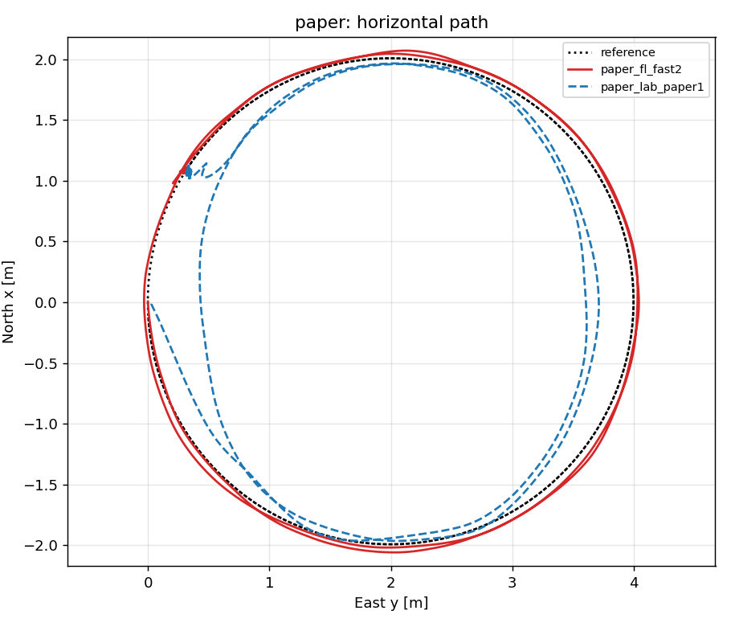
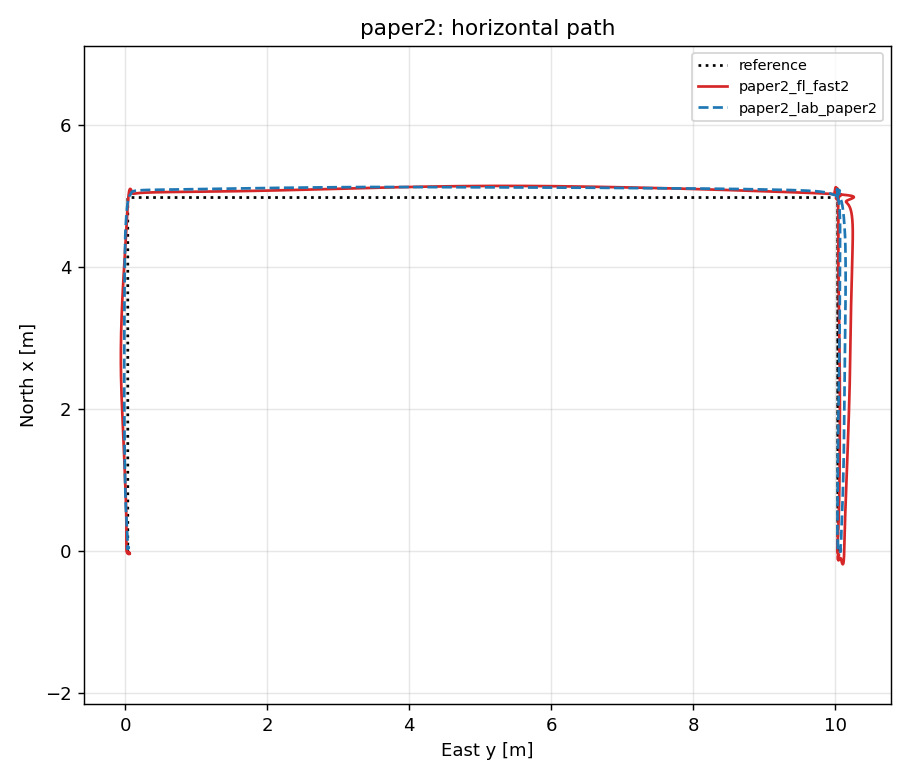
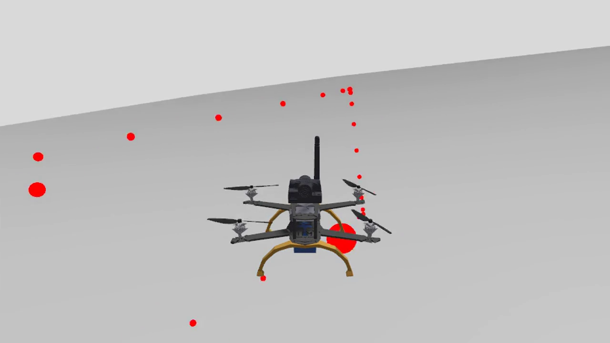

# 1. What this project is

Two trajectory-tracking controllers from the paper *Linear Algebra Based Tracking Control of a Drone* (P. Albertos et al., IET Control Theory & Applications, 2025) are implemented as **native PX4 v1.17 flight modes**:

- **LAB** (Linear Algebra Based): a discrete law that needs the reference at samples *i* and *i+1*.
- **FL** (Feedback Linearization): dynamic extension with pole-placement gains.

Both bypass PX4's position, attitude and rate controllers and publish the thrust and torque setpoints directly (`vehicle_thrust_setpoint`, `vehicle_torque_setpoint`). That is the closest to the paper's plant (angular acceleration = torque / inertia). The target is the lab drone, a Pixhawk 2.4.8 (board `fmu-v3`). The goal is to **compare LAB and FL** on that drone, indoors, with a Marvelmind positioning system.

Everything is in one repository: `https://github.com/racarla96/PX4-Autopilot`, branch `feature/lab-fl-modes` (PX4 v1.17.0 plus our commits). It is a private fork: ask for access.

## 1.1 Status at a glance

| Area | State |
|---|---|
| LAB and FL modes, trajectory generator, safety monitor | Done. Unit tests pass. Built for `fmu-v3` (flash 98.68 % used). |
| Simulation (Gazebo x500) of the paper's two trajectories | Done. Results in section 4. |
| Gazebo model of the lab drone (ZMR250) from its CAD, weights and motor bench data | Done, but the drone is **too weak** (thrust-to-weight 1.36). Hardware change decided in principle, section 5. |
| Marvelmind indoor positioning | **Studied, not tested.** Plan in section 6. |
| Anything on real hardware | **Not done.** All results so far are simulation. |

# 2. Repository map

| What | Where |
|---|---|
| Reference generator (circle, paper trajectory 1 and 2) | `src/modules/traj_generator` |
| LAB law and module | `src/modules/lab_control` |
| FL law and module | `src/modules/fl_control` |
| Shared code (inputs, hover thrust, heading compensation, safety monitor) | `src/lib/traj_control_common` |
| Simulation helper, experiments, analysis | `Tools/lab_fl/` (`sitl.sh`, `experiment.sh`, `analyze.py`) |
| Gazebo model of the lab drone and its generator | `Tools/lab_fl/gz/` |
| Videos | `Tools/lab_fl/videos/` |
| Safety, differences with the paper | `Tools/lab_fl/SAFETY.md`, `Tools/lab_fl/PAPER_DIFFERENCES.md` |
| The paper and the original MATLAB/Simulink code | repository `Paper-Pedro-Albertos-Simulacion-LAB-Controller` (CO3-UPV) |
| CAD and motor bench data of the TFE | repository `TFE_Mario_Bleda_Simulacion_Drone` |

Read first, in this order: this guide, `Tools/lab_fl/README.md`, `PAPER_DIFFERENCES.md`, `SAFETY.md`, `Tools/lab_fl/gz/README.md`.

# 3. Step by step: get it running

**Step 1. Tools.** Ubuntu 24.04 (the project was developed there), Docker, Gazebo Harmonic (`gz sim --versions` shows 8.x), FreeCAD (only to regenerate meshes from CAD), `ffmpeg` (videos), QGroundControl.

**Step 2. Clone.**

    git clone https://github.com/racarla96/PX4-Autopilot.git
    cd PX4-Autopilot && git checkout feature/lab-fl-modes && git submodule update --init --recursive

**Step 3. Python environment** (analysis and the Gazebo build). Create a virtualenv and install the PX4 requirements plus `pyulog`:

    python3 -m venv --system-site-packages ~/px4venv && ~/px4venv/bin/pip install -r Tools/setup/requirements.txt pyulog

If `matplotlib` from the system fails with a NumPy error, install `numpy<2` in the virtualenv.

**Step 4. Build the firmware for the real board** (inside Docker, no ARM toolchain needed on the host):

    docker run --rm -u $(id -u):$(id -g) -v "$PWD":/src -w /src -e HOME=/tmp px4io/px4-dev:v1.17.0 make px4_fmu-v3_default

Check the size with `arm-none-eabi-size build/px4_fmu-v3_default/px4_fmu-v3_default.elf` (text + data, limit 2,080,768 B). It is at 98.68 %, about 27 KB free. If a change makes the build stop fitting, run `Tools/lab_fl/trim_fmu-v3_flash.sh` (removes fixed-wing, VTOL, UUV, airspeed and fake GPS, about 126 KB).

**Step 5. Unit tests** (law, trajectories, safety monitor). Configure the test build once and run them in Docker:

    docker run --rm -u $(id -u):$(id -g) -v "$PWD":/src -w /src -e HOME=/tmp px4io/px4-dev:v1.17.0 make px4_sitl_test
    # then, from build/px4_sitl_test: ninja unit-LabControlLawTest unit-FlControlLawTest unit-TrajectoryProfileTest unit-SafetyMonitorTest && ./unit-<name>

**Step 6. Build the Gazebo simulation** on the host (needs Gazebo Harmonic) and fly:

    PATH=~/px4venv/bin:$PATH make px4_sitl_default BUILD_DIR_SUFFIX=_gz
    Tools/lab_fl/sitl.sh start gz paper2      # x500; use VEHICLE=zmr250 for the lab drone
    Tools/lab_fl/sitl.sh gains fl fast2       # or: lab paper2
    Tools/lab_fl/sitl.sh demo fl              # arms, takes off, switches to the mode
    Tools/lab_fl/sitl.sh hold; Tools/lab_fl/sitl.sh land; Tools/lab_fl/sitl.sh stop

QGroundControl connects by itself (UDP 14550). The simulator has no radio, so `sitl.sh` runs a virtual joystick (`mc_send.py` in Docker): the modes need a manual control link.

**Step 7. Automatic experiment and analysis.**

    Tools/lab_fl/experiment.sh paper2 fl fast2               # log in ~/px4_sitl_labfl/runs/
    ~/px4venv/bin/python Tools/lab_fl/analyze.py --out out ~/px4_sitl_labfl/runs/*.ulg

`analyze.py` writes `metrics.csv` (RMSE per axis, 3D RMSE and maximum, yaw error, torque, tilt, saturation) and the plots of each trajectory.

**Step 8. Reproduce section 4.** Fly the four best configurations and compare your numbers with the table. Differences of a few percent are normal (one flight per configuration).

# 4. What has been found (Gazebo, x500)

{width=48%} {width=48%}

| Trajectory | Controller | 3D RMSE [m] | Yaw RMSE [deg] |
|---|---|---|---|
| Paper 1 | LAB, paper gains | 0.34 | 2.8 |
| Paper 1 | FL, `fast2` | 0.058 | 0.41 |
| Paper 2 | LAB, paper gains | 0.056 | 0.43 |
| Paper 2 | FL, `fast2` | 0.19 | 1.4 |

Things you must know, with the reason:

1. **The paper's model has no yaw in the translation.** The real vehicle does. Without the **heading compensation** (`TCC_HDG_COMP`, on by default) any trajectory with changing yaw diverges. The yaw is not projected: the desired horizontal acceleration is rotated by the measured heading.
2. **FL with the paper's filtered derivatives diverges** as soon as the plant has any lag. We compute acceleration and jerk from the model (`FL_MODEL_DERIV 1`). Details in `PAPER_DIFFERENCES.md` (also available as a Spanish PDF).
3. **LAB gains do not transfer between trajectories** (the sample time they were designed for is part of the design: 0.02 s for trajectory 1, 0.01 s for trajectory 2).
4. **"Saturation" in `analyze.py` has three parts.** Thrust, torque and tilt. "Torque" means the commanded angular acceleration hit the limits of the laws (`TCC_ALPHA_XY/Z`, the paper's +-10 and +-1 rad/s^2), not that a motor saturated. In the lab-drone flights the thrust never saturated.
5. **Safety.** The modes leave to Hold on lost inputs, large error, distance, height, tilt or controller failure. PX4's own failsafes still apply. Read `SAFETY.md` before any flight.

# 5. The lab drone: what has been done and the decision pending

## 5.1 Model of the ZMR250

`Tools/lab_fl/gz/` builds a Gazebo model of the lab drone from: the CAD of the TFE, the weights, and the thrust-bench data of the motor (`data/motor_1806_4045_4S.csv`). It is **generated**: edit `zmr250.toml` (masses and positions, each with a status: measured, datasheet or estimate) and run `make_model.py`.

    python3 Tools/lab_fl/gz/make_model.py          # rewrites the SDF, the SITL airframe, params and mass_report.md
    VEHICLE=zmr250 Tools/lab_fl/sitl.sh start gz paper2
    VEHICLE=zmr250 Tools/lab_fl/experiment.sh paper2 fl fast2

Result for the drone as built (ZMR250 frame, four 1806 2280 KV motors, 4045 propellers, 4S): mass 637 g, inertia 1.71e-3, 1.86e-3, 2.76e-3 kg m^2, **thrust-to-weight 1.36**, hover at 74 % of the maximum thrust. The inertia in the old MATLAB (0.0552 kg m^2) is about 30 times too large.

{width=70%}

## 5.2 Why the hardware has to change

With thrust-to-weight 1.36 the thrust demand of trajectory 2 peaks at 88 % of the maximum thrust, with the limit of the modes (`TCC_THR_MAX`) at 90 %: it only just fits in simulation with a full battery. Thrust falls with the battery voltage (my estimate: about 1.2 of thrust-to-weight at 14.8 V), so a real flight would saturate. The target is at least 1.5 at low battery voltage, better 2.

## 5.3 Recommended replacement (to be confirmed)

DJI F450-class frame (450 mm, motors about 318 mm apart), **EMAX MT2213 935 KV** motors, **8045** propellers (8x4.5 in), **4S** battery, 30 A ESC. Estimated mass about 1.0 kg, maximum thrust about 8.4 N per motor (vendors quote 850 to 863 g), so thrust-to-weight about 3.4. These are estimates from retailer pages; the figures disagree between vendors.

- **Do not use the 1045 propeller on 4S**: the motor would draw about 30 A (estimate), far above its rating. The 1045 pairs with 3S.
- The MT2213 does **not** fit the ZMR250: propellers of 8 in or more overlap there (adjacent motors 157 mm apart).
- Bigger propellers have more inertia: the **rotor speed lag will be larger**. That matters for LAB, see 5.4.

## 5.4 The rotor lag decides whether LAB flies

The model uses a first-order rotor lag (default 30 ms, the value the TFE used as a setting; the bench sweep is quasi-static, so it is **not identified**). Second trajectory, ZMR250 model, one flight per cell:

| Rotor lag | LAB, paper gains | FL, `fast2` |
|---|---|---|
| 12.5 ms | 0.056 m, yaw 0.5 deg | 0.198 m, yaw 2.0 deg |
| 20 ms | leaves the mode after 1.9 s | 0.199 m, yaw 2.2 deg |
| 30 ms | leaves the mode after 0.6 s | 0.203 m, yaw 2.1 deg |
| 50 ms | leaves the mode after 0.5 s | 0.198 m, yaw 2.1 deg |

FL does not depend on the lag in this range. LAB with the paper's gains only works for about 12 ms or less (they are an almost deadbeat design for an ideal actuator); with the module defaults it also failed at 30 ms. **Measure the real lag** (step response of the rotor speed, section 7, step 3) and redesign the LAB gains for it: this is the main open technical task.

# 6. Marvelmind indoor positioning (planned, not tested)

Architecture: **NIA** (non-inverse): stationary Super-Beacons receive, the mobile beacon on the drone transmits, a modem controls the network. Material in the lab: three Starter Sets Super-MP-3D (one with HW v4.9 beacons, two with HW 5.1). The vendor's placement manual is the reference for the room.

How it reaches PX4 (from the vendor manual, chapter 11): the mobile Super-Beacon emulates a GPS and sends **NMEA0183** over UART to the Pixhawk's GPS port. PX4 already has the NMEA driver, so **no new code and no flash**:

- UART of the beacon to `GPS1` (`/dev/ttyS3`), set `GPS_1_PROTOCOL = 6` (NMEA is not auto-detected).
- Georeference the map's point (0,0) in the Dashboard and rotate the map so that its **Y axis points to true north**.
- Tune `EKF2_GPS_DELAY` (the measurement latency), `EKF2_GPS_P_NOISE` (about 2 cm accuracy) and `EKF2_GPS_P_GATE`.
- Licences (per beacon, paid, from the vendor): none for basic NMEA. Yaw from paired beacons needs MMSW0002 (`$GPHDT`) or MMSW0003 (UBX for PX4); 100 Hz NMEA needs MMSW0001 and only works with HW v4.9-IMU beacons. Prices are on the vendor's shop.
- Yaw: for now it comes from the Pixhawk's magnetometer, which may be poor indoors.

Open points to measure on the bench: which NMEA sentences the beacon sends (the EKF GPS checks may need relaxing), the baud rate, the update rate and the latency. Four stationary beacons give no vertical redundancy; the manual recommends six for a stable Z on a drone.

# 7. What to do next, in order

| # | Task | Done when |
|---|---|---|
| 1 | Confirm the hardware with the supervisor (section 5.3). Get the real weight of each part and a CAD of the frame (or accept a simple geometry). | A list of parts with weights |
| 2 | Bench-test the motor and propeller (8045 on the MT2213, 4S): thrust, torque, current and rpm against PWM, RCbenchmark format. | A CSV like `data/motor_1806_4045_4S.csv` |
| 3 | Measure the **rotor speed lag** with a PWM step at the bench. | A time constant in ms (up and down) |
| 4 | Regenerate the simulation model with the new data (`zmr250.toml`, a new frame geometry). Check `mass_report.md`: thrust-to-weight at least 1.5. | Report with the new numbers |
| 5 | Re-fly the four sections 4 and 5.4 experiments. **Redesign the LAB gains** for the measured lag. | Table of results for the lab drone |
| 6 | Calibrate the `TCC_*` parameters for the real drone (mass, inertia, torque scales, hover thrust) from the generated `params/*.params`, and check the motor numbering and spin directions. | Parameters loaded, checked against the model |
| 7 | Marvelmind: bench capture of the NMEA stream, then a flight in Position mode with it. | The EKF fuses the position without rejections in the log |
| 8 | Hardware tests: rig without propellers, then with propellers on a rig, then a hover, then free flight in Position, then LAB and FL on the circle at a small `TRJ_AMP` and a low `TRJ_FREQ`, then the paper's trajectories (task 10 first). | Logs of each stage |
| 9 | Compare LAB and FL on the real drone with `analyze.py`. | The report |
| 10 | **Software, before task 8's last stage:** add a time-scale parameter to the paper trajectories in `traj_generator` (see recommendation 4). | First flights at a slow pace |
| 11 | **Pending, low priority:** a VL53L0X distance sensor facing down (I2C) for take-off and landing and as a complementary height measurement. The driver is already in the `fmu-v3` firmware (no extra flash). Use the conditional mode `EKF2_RNG_CTRL = 1` (range used only at low speed and low altitude). Its range is about 2 m (check the data sheet), so it cannot help in the upper part of the trajectories. Not in the simulation model yet. | Height from the sensor below its range, in the log |

# 8. Recommendations

1. **One change at a time, and a log of each flight.** Run `analyze.py` after every flight and keep the `.ulg` with a name that says what it is.
2. **Never trust an estimate that has not been measured.** The lag, the thrust at low battery and the inertia are the three that decide the result. `zmr250.toml` marks each mass as measured, datasheet or estimate: keep that honest.
3. **Thrust falls with the battery voltage.** The bench ran at 16.8 to 15.9 V. Always check the margin at the lowest voltage you will fly.
4. **The paper trajectories are violent and fixed** (the second reaches 4.4 m/s and 1.4 rad/s of yaw). `TRJ_AMP` and `TRJ_FREQ` only change the circle (type 1): the paper trajectories have no scale parameter yet. Add one (a time stretch: acceleration falls with the square of the duration) before the first real flights, and meanwhile use the circle at a small amplitude.
5. **First flights without propellers, then tethered.** Keep a mode switch for Hold on the transmitter at all times.
6. **Flash is almost full** (98.68 %). Check the size after every firmware change.
7. **Set up the simulator with default parameters.** `sitl.sh start gz` already deletes the saved parameters, so each run starts clean.
8. **Document what you change in the repository**, in the same style: a short README per tool and a note in `PAPER_DIFFERENCES.md` when a result depends on a design decision.

# 9. Cheat sheet

| Parameter | Meaning |
|---|---|
| `TRJ_TYPE` | 1 circle, 3 paper trajectory 1, 4 paper trajectory 2 |
| `TRJ_AMP`, `TRJ_FREQ` | amplitude and frequency of the circle only (type 1); the paper trajectories are fixed |
| `TRJ_DURATION` | duration of the circle (0 = forever) |
| `TCC_MASS`, `TCC_IXX/IYY/IZZ` | vehicle model used by the laws |
| `TCC_TQ_MAX_XY`, `TCC_TQ_MAX_Z` | physical torque at a normalized torque of 1 (from the thrust and the lever arm) |
| `TCC_THR_MIN/MAX`, `TCC_TILT_MAX` | thrust and tilt limits of the laws |
| `TCC_TS` | sample time (0.02 s; 0.01 s for the paper's trajectory 2) |
| `TCC_HDG_COMP` | heading compensation (1 = on) |
| `TCC_ERR_MAX`, `TCC_DIST_MAX`, `TCC_ALT_MAX`, `TCC_TILT_ABORT`, `TCC_FAIL_TOUT` | safety limits (0 disables a check) |
| `LAB_K1..K12` | LAB gains |
| `FL_K11..K34`, `FL_K41/K42`, `FL_MODEL_DERIV` | FL gains and derivative source |
| `GPS_1_PROTOCOL` (6) | NMEA, for the Marvelmind beacon |

| Command | What it does |
|---|---|
| `sitl.sh start gz <circle,paper,paper2>` | start the Gazebo simulation (`VEHICLE=zmr250` for the lab drone) |
| `sitl.sh gains <lab,fl> <robust,paper1,paper2,fast2>` | load a gains preset |
| `sitl.sh demo <lab,fl>` | take off and enter the mode |
| `sitl.sh hold, land, stop, cmd "<px4 command>", log` | back to Hold, land, stop, any PX4 shell command, follow the console |
| `experiment.sh <traj> <ctrl> <gains>` | one automatic flight, log saved |
| `analyze.py --out out <logs>` | metrics and plots |
| `gz/make_model.py` | regenerate the Gazebo model, the SITL airframe and the parameter file |
| `gz/sweep_motor_lag.sh` | fly the second trajectory for several rotor lags |
| `videos/make_video.sh <traj> <ctrl> <gains>` | record a video of a flight |

# 10. References

- P. Albertos, P. del Río, C. Wei, A. Cuenca, *Linear Algebra Based Tracking Control of a Drone*, IET Control Theory & Applications 19, e70074 (2025), https://doi.org/10.1049/cth2.70074
- PX4 documentation, https://docs.px4.io (v1.17)
- Marvelmind Robotics: Placement manual and Operating manual (chapter 11, communication with Pixhawk), https://marvelmind.com/download/
- In this repository: `Tools/lab_fl/README.md`, `SAFETY.md`, `PAPER_DIFFERENCES.md`, `gz/README.md`.
